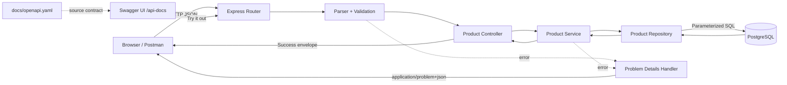
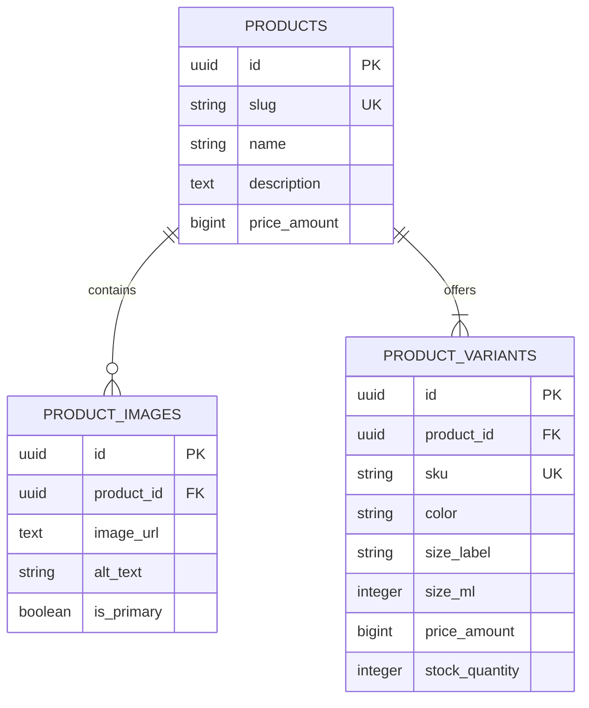

# Arsitektur Product Catalog API

## 1. Tujuan

Dokumen ini mendefinisikan arsitektur target API katalog produk menggunakan Node.js, Express.js, dan PostgreSQL. API menyimpan nama, harga, foto, deskripsi, pilihan varian (misalnya warna/aroma dan ukuran), serta jumlah stok tiap varian.

Arsitektur ini mengganti asumsi penyimpanan in-memory pada PRD API: PostgreSQL menjadi sumber data persisten. Data harga Rp99.000, stok, dan foto konsep Iqlifar tetap data contoh sampai pemilik produk memverifikasinya.

## Keputusan Teknologi

| Area | Pilihan | Alasan dan batasan |
| --- | --- | --- |
| Runtime | Node.js versi LTS yang didukung proyek | JavaScript untuk backend; patok versi di `engines` dan `.nvmrc`. |
| Framework HTTP | Express.js | Ringan untuk REST API dan mudah memisahkan route/controller/middleware. |
| Database | PostgreSQL | Relasional, constraint kuat, dan transaksi untuk membuat produk beserta foto/varian secara atomik. |
| Database client | `pg` (node-postgres) | SQL eksplisit dan parameterized queries. |
| Dokumentasi | OpenAPI 3.1 + Swagger UI | Spesifikasi disimpan sebagai `docs/openapi.yaml`; Swagger UI disajikan oleh backend pada `/api-docs`. |
| Validasi | Middleware schema validator (mis. Zod) | Validasi server-side dan reject property tak dikenal; satu schema mendokumentasikan request contract. |
| Migrasi | SQL migration berurutan | Perubahan schema dapat ditinjau dan diterapkan konsisten. |
| Foto | URL HTTPS ke object storage/CDN | Database menyimpan URL dan metadata, bukan binary foto. |
| Error API | RFC 9457 Problem Details | Bentuk error standar; success memakai envelope proyek yang dijelaskan di bawah. |

Pilihan library validasi dapat ditetapkan saat implementasi. Jika memakai Zod, gunakan object schema yang strict agar property tambahan tidak diabaikan.

## Diagram Arsitektur

```text
Browser / Postman
       │ HTTP JSON
       ▼
Express API (/api/v1)
       │
       ├── Route → Middleware validasi → Controller
       │                                  │
       │                                  ▼
       │                                Service
       │                                  │
       │                                  ▼
       │                              Repository
       │                                  │ SQL / pg
       ▼                                  ▼
 RFC 9457 error / success JSON       PostgreSQL
```

Express menjalankan HTTP API dan middleware. PostgreSQL menyimpan data katalog. `pg` (node-postgres) mengakses PostgreSQL melalui connection pool dan parameterized queries. Foto disimpan di object storage atau layanan media; database hanya menyimpan URL/metadata foto, bukan binary image.

### Diagram Arsitektur Backend dan Swagger



`GET /api-docs` menyajikan Swagger UI dan `GET /api-docs/openapi.yaml` menyajikan kontrak OpenAPI. Swagger UI membaca spec yang sama dengan dokumentasi repository dan menyediakan `Try it out` untuk API yang sedang berjalan. Akses docs dapat dibatasi pada deployment.

## Layered Architecture MVC

MVC mengatur lapisan HTTP, sementara service/repository memisahkan aturan bisnis dan akses persistence.

```text
api-product/
├── src/
│   ├── app.js
│   ├── server.js
│   ├── config/
│   │   └── database.js
│   ├── docs/
│   │   └── swagger.js             # mount Swagger UI dan OpenAPI spec
│   ├── routes/
│   │   └── product.routes.js
│   ├── controllers/
│   │   └── product.controller.js
│   ├── services/
│   │   └── product.service.js
│   ├── repositories/
│   │   └── product.repository.js
│   ├── models/
│   │   └── product.model.js
│   ├── validators/
│   │   └── product.validator.js
│   ├── middlewares/
│   │   ├── validate-request.js
│   │   ├── not-found.js
│   │   └── error-handler.js
│   ├── errors/
│   │   └── app-error.js
│   └── utils/
│       ├── slug.js
│       └── response.js
├── db/
│   ├── migrations/
│   │   └── 001_create_catalog_tables.sql
│   └── seeds/
│       └── products.seed.sql
├── docs/
│   └── openapi.yaml
├── .env.example
├── package.json
└── README.md
```

Dokumentasi OpenAPI harus mencakup seluruh endpoint, schema request dan response, status HTTP, format error RFC 9457, serta contoh payload. Jangan hanya mendokumentasikan GET; POST beserta respons validasi juga menjadi bagian kontrak.

| Lapisan | Tanggung jawab |
| --- | --- |
| Routes | Memetakan method/path ke middleware dan controller. |
| Middleware/validators | Memeriksa request body/parameter sebelum handler; request invalid berhenti di sini. |
| Controllers | Mengambil input HTTP, memanggil service, menetapkan status/header, membentuk success envelope. Tidak berisi SQL atau aturan katalog. |
| Services | Menjalankan use case, aturan bisnis, availability, dan transaksi yang dibutuhkan. Tidak mengimpor Express. |
| Repositories | Menjalankan query PostgreSQL dengan parameter; memetakan row ke model/domain. Tidak menangani HTTP. |
| Models | Mendefinisikan bentuk dan aturan dasar entitas Product, ProductImage, dan ProductVariant. Bukan tempat query SQL. |
| Error middleware | Memetakan error terstruktur ke Problem Details RFC 9457 tanpa membocorkan stack trace. |

Dependency mengalir dari route/controller menuju service, lalu repository dan database. Repository tidak memanggil service/controller. Database hanya diakses melalui repository.

## Model Data

Model memisahkan produk, foto, dan varian. Satu produk memiliki satu atau lebih varian; setiap varian dapat memiliki aroma/warna, ukuran, SKU, harga khusus opsional, dan stok sendiri. `stock_quantity` berarti stok yang tersedia untuk varian tersebut, bukan jumlah yang sedang dipilih pengguna di UI/cart.

### Relasi



Relasi Product `1:N` ProductImage dan Product `1:N` ProductVariant. Foreign key memastikan foto dan varian terkait ke produk yang ada.

### Tabel Product

| Kolom | Tipe | Aturan/kegunaan |
| --- | --- | --- |
| `id` | UUID | Primary key. |
| `slug` | VARCHAR(120) | Identifier URL yang unik. |
| `name` | VARCHAR(120) | Nama produk wajib. |
| `description` | TEXT | Deskripsi plain text. |
| `price_amount` | BIGINT | Harga integer; IDR 99000 berarti Rp99.000. |
| `currency` | CHAR(3) | MVP dibatasi IDR. |
| `is_active` | BOOLEAN | Produk aktif ditampilkan oleh GET. |
| `created_at`, `updated_at` | TIMESTAMPTZ | Timestamp UTC. |

### Tabel ProductImage

| Kolom | Tipe | Aturan/kegunaan |
| --- | --- | --- |
| `id` | UUID | Primary key. |
| `product_id` | UUID | Foreign key ke Product. |
| `image_url` | TEXT nullable | HTTPS URL atau null untuk placeholder yang belum memiliki foto aktual. |
| `alt_text` | VARCHAR(200) | Teks alternatif gambar. |
| `sort_order` | SMALLINT | Urutan galeri, tidak negatif. |
| `is_primary` | BOOLEAN | Maksimal satu primary per produk; service memastikan satu primary bila foto aktual tersedia. |

### Tabel product_variants

| Kolom | Tipe | Aturan/kegunaan |
| --- | --- | --- |
| `id` | UUID | Primary key. |
| `product_id` | UUID | Foreign key ke Product. |
| `sku` | VARCHAR(80) | SKU kombinasi yang unik. |
| `variant_name` | VARCHAR(80) | Label aroma/karakter seperti Iqlima atau Fariz. |
| `color` | VARCHAR(60) nullable | Warna atau atribut pilihan sejenis. |
| `size_label` | VARCHAR(40) nullable | Label tampilan seperti `50 ml`. |
| `size_ml` | INTEGER nullable | Ukuran numerik bila tersedia. |
| `price_amount` | BIGINT nullable | Harga override; null memakai harga Product. |
| `stock_quantity` | INTEGER | Stok SKU (>= 0), bukan quantity di cart. |
| `is_active` | BOOLEAN | Menentukan varian yang dapat dipilih. |

### Schema SQL Awal

```sql
CREATE EXTENSION IF NOT EXISTS pgcrypto;

CREATE TABLE products (
  id UUID PRIMARY KEY DEFAULT gen_random_uuid(),
  slug VARCHAR(120) NOT NULL UNIQUE,
  name VARCHAR(120) NOT NULL,
  description TEXT NOT NULL,
  price_amount BIGINT NOT NULL CHECK (price_amount > 0),
  currency CHAR(3) NOT NULL DEFAULT 'IDR',
  is_active BOOLEAN NOT NULL DEFAULT TRUE,
  created_at TIMESTAMPTZ NOT NULL DEFAULT NOW(),
  updated_at TIMESTAMPTZ NOT NULL DEFAULT NOW(),
  CONSTRAINT products_currency_supported CHECK (currency = 'IDR')
);

CREATE TABLE product_images (
  id UUID PRIMARY KEY DEFAULT gen_random_uuid(),
  product_id UUID NOT NULL REFERENCES products(id) ON DELETE CASCADE,
  image_url TEXT,
  alt_text VARCHAR(200) NOT NULL,
  sort_order SMALLINT NOT NULL DEFAULT 0 CHECK (sort_order >= 0),
  is_primary BOOLEAN NOT NULL DEFAULT FALSE,
  created_at TIMESTAMPTZ NOT NULL DEFAULT NOW(),
  CONSTRAINT product_images_https_or_placeholder CHECK (
    image_url IS NULL OR image_url LIKE 'https://%'
  )
);

CREATE TABLE product_variants (
  id UUID PRIMARY KEY DEFAULT gen_random_uuid(),
  product_id UUID NOT NULL REFERENCES products(id) ON DELETE CASCADE,
  sku VARCHAR(80) NOT NULL UNIQUE,
  variant_name VARCHAR(80) NOT NULL,
  color VARCHAR(60),
  size_label VARCHAR(40),
  size_ml INTEGER CHECK (size_ml IS NULL OR size_ml > 0),
  price_amount BIGINT CHECK (price_amount IS NULL OR price_amount > 0),
  stock_quantity INTEGER NOT NULL DEFAULT 0 CHECK (stock_quantity >= 0),
  is_active BOOLEAN NOT NULL DEFAULT TRUE,
  created_at TIMESTAMPTZ NOT NULL DEFAULT NOW(),
  updated_at TIMESTAMPTZ NOT NULL DEFAULT NOW(),
  CONSTRAINT variant_has_option CHECK (
    color IS NOT NULL OR size_label IS NOT NULL OR size_ml IS NOT NULL
  )
);

CREATE INDEX product_images_product_order_idx
  ON product_images (product_id, sort_order, id);

CREATE UNIQUE INDEX product_images_one_primary_per_product_idx
  ON product_images (product_id)
  WHERE is_primary = TRUE;

CREATE INDEX product_variants_product_active_idx
  ON product_variants (product_id, is_active);
```

### Makna Kolom dan Relasi

- `products.name`, `description`, `price_amount`, dan `currency` memenuhi data pokok halaman detail. Harga produk berlaku sebagai harga default.
- `product_images` menyimpan metadata foto. `image_url` menunjuk HTTPS URL yang dapat diakses frontend; nilai `NULL` hanya untuk placeholder mockup yang belum memiliki aset foto aktual. Constraint index mengizinkan maksimal satu foto utama per produk; aplikasi memastikan tepat satu primary jika URL foto tersedia.
- `product_variants.color` menampung warna atau nama karakter/aroma (misalnya `Iqlima`/`Fariz`). `size_label` untuk tampilan (misalnya `50 ml`) dan `size_ml` untuk nilai numerik opsional.
- `product_variants.price_amount` dapat meng-override harga produk jika suatu ukuran/varian memiliki harga berbeda; `NULL` berarti memakai `products.price_amount`.
- `stock_quantity` merupakan inventori per SKU. API mengembalikan jumlah ini sebagai `quantity`/stock untuk UI membatasi pemilihan jumlah. Perubahan stok transaksi/checkout belum termasuk scope.
- Harga disimpan sebagai integer dalam unit terkecil mata uang. Untuk scope IDR, `99000` berarti Rp99.000. Mata uang selain IDR memerlukan kebijakan unit minor yang eksplisit sebelum constraint currency diperluas.
- `created_at` dan `updated_at` memakai UTC. Aplikasi memperbarui `updated_at` setiap kali record berubah.

PostgreSQL tidak dapat membuat partial unique index yang memastikan tepat satu foto utama untuk setiap parent yang memiliki foto tanpa constraint tambahan/deferred trigger. Pada MVP, service memvalidasi kondisi itu dalam transaksi saat membuat/mengubah kumpulan foto; index di atas mencegah lebih dari satu foto utama.

### Contoh Seed Konseptual

Produk Iqlifar dapat direpresentasikan sebagai satu row `products`, lalu empat row varian: Iqlima 50 ml, Iqlima 100 ml, Fariz 50 ml, dan Fariz 100 ml. Setiap row menyimpan stoknya sendiri. Nilai harga/stok tersebut tetap data contoh. Foto CSS mockup tidak dimasukkan sebagai URL foto produk aktual; sediakan asset mockup frontend sampai foto sungguhan tersedia.

## Pemetaan database response

Base path: `/api/v1`.

| Endpoint | Data source | Catatan |
| --- | --- | --- |
| `GET /api/v1/products` | `products` dengan `product_images` dan `product_variants` | Hanya produk aktif; dapat menambah pagination saat katalog berkembang. |
| `GET /api/v1/products/:id` | Join produk, foto, varian | Lookup UUID atau slug sesuai kontrak route; pilih satu format ID secara konsisten. |
| `POST /api/v1/products` | Insert product, images, variants | Satu transaksi; rollback penuh jika salah satu insert/validasi database gagal. |

### Bentuk Respons Sukses

Gunakan success envelope yang sama seperti PRD API. Status HTTP tetap sumber status utama dan tidak diduplikasi dalam body.

```json
{
  "success": true,
  "message": "Product retrieved successfully.",
  "data": {
    "id": "uuid",
    "slug": "iqlifar",
    "name": "Iqlifar Store Parfum",
    "description": "Koleksi parfum dengan dua karakter aroma.",
    "price": { "amount": 99000, "currency": "IDR" },
    "images": [
      { "url": "https://cdn.example.test/iqlifar.jpg", "alt": "Botol Iqlifar", "isPrimary": true }
    ],
    "variants": [
      {
        "id": "uuid",
        "sku": "IQLIMA-50",
        "name": "Iqlima",
        "color": "Iqlima",
        "size": { "label": "50 ml", "ml": 50 },
        "price": null,
        "stockQuantity": 10
      }
    ],
    "availability": "in_stock"
  },
  "meta": {}
}
```

`availability` diturunkan dari varian aktif: `in_stock` jika setidaknya satu `stockQuantity` lebih dari nol, selain itu `out_of_stock`. Jangan menyimpan nilai turunan tersebut sebagai kolom terpisah karena dapat tidak sinkron dengan stok varian.

Error mengikuti RFC 9457 `application/problem+json` sebagaimana didefinisikan di `api-prd.md`. Gunakan kode error stabil seperti `PRODUCT_NOT_FOUND`, `VALIDATION_ERROR`, dan `PRODUCT_ALREADY_EXISTS`; jangan mengirim query SQL atau stack trace ke client.

## Alur setiap operasi

### GET daftar produk

1. Route `GET /api/v1/products` meneruskan query yang sudah divalidasi ke controller.
2. Controller memanggil `productService.listProducts`.
3. Service meminta data produk aktif beserta foto dan varian dari repository.
4. Repository menjalankan query PostgreSQL terparameterisasi. Query harus menghindari duplikasi produk akibat join one-to-many, misalnya dengan query terpisah atau agregasi terkontrol.
5. Service memetakan hasil ke DTO dan menghitung `availability` dari stok varian aktif.
6. Controller mengirim `200` dengan success envelope dan metadata count/pagination.

### GET detail produk

1. Route memvalidasi format `:id` (UUID atau slug; pilih satu kontrak sebelum implementasi).
2. Controller memanggil `productService.getProductById`.
3. Service meminta detail beserta foto dan varian ke repository.
4. Jika produk tidak ada/tidak aktif, service menghasilkan `PRODUCT_NOT_FOUND`; error handler mengirim `404` Problem Details.
5. Jika ditemukan, service membentuk DTO lengkap dan controller mengirim `200` success envelope.

### POST produk

1. JSON parser memvalidasi media type dan batas body.
2. Middleware validasi mengecek schema; input invalid dihentikan dengan `400` Problem Details sebelum controller.
3. Controller meneruskan payload valid ke `productService.createProduct`.
4. Service menormalkan slug dan memeriksa invariant bisnis seperti SKU unik dan primary image.
5. Repository membuka transaksi, lalu insert Product, ProductImage, dan ProductVariant.
6. Jika semua insert berhasil, commit; jika satu gagal, rollback seluruh operasi.
7. Service memetakan resource baru dan controller mengirim `201`, header `Location`, serta success envelope.
8. Unique constraint violation menjadi `409 PRODUCT_ALREADY_EXISTS`; detail SQL tidak dikirim ke client.

## Aturan validasi dan pertahanan data

### Validasi request

- Semua input divalidasi di server; validasi frontend hanya untuk UX.
- JSON body maksimal 100 KB, harus objek, dan hanya menerima `application/json`.
- Tolak property yang tidak dikenal di root maupun objek nested (allowlist/strict schema).
- Trim string dan batasi panjang nama, slug, deskripsi, alt text, SKU, serta panjang array.
- Harga integer positif dan aman; `stock_quantity` integer >= 0; `size_ml` integer positif bila disediakan.
- `currency` hanya IDR pada MVP. Tolak pecahan, nilai negatif, `NaN`, dan overflow.
- URL foto harus HTTPS valid atau null hanya untuk placeholder konsep. Tolak data URI dan protocol lain.
- SKU dan slug unik; konflik menghasilkan `409`.
- Jika `size_label` dan `size_ml` sama-sama dikirim, nilainya harus konsisten (contoh `50 ml` dan `50`).

### Pertahanan aplikasi dan database

- Gunakan parameterized SQL (`$1`, `$2`); jangan gabungkan input pengguna ke string SQL.
- Terapkan `NOT NULL`, `CHECK`, foreign key, unique constraint, serta index di PostgreSQL sebagai lapisan integritas kedua.
- Gunakan transaksi untuk operasi lintas tabel; controller tidak mendapat akses langsung ke koneksi DB.
- Batasi hasil/pagination dan ukuran request untuk mencegah beban tak terbatas.
- Gunakan role PostgreSQL dengan hak minimum; application user bukan superuser atau pemilik schema.
- Simpan kredensial di environment/secret manager, jangan commit `.env`, dan jangan tulis secret ke log.
- Error client hanya berisi pesan publik, kode stabil, serta field invalid; stack trace/SQL hanya di log server terkontrol.
- Render teks produk dengan escaping (`textContent`/framework escaping), bukan sebagai HTML mentah.
- Backend tidak boleh mengambil URL gambar arbitrer dari request. Jika kelak melakukan image processing, batasi host, redirect, dan ukuran untuk mengurangi SSRF.
- CORS menggunakan allowlist origin. CORS bukan autentikasi; endpoint POST produksi membutuhkan autentikasi/otorisasi admin.
- Log request ID, route, status, dan durasi tanpa mencatat credential atau payload yang tidak diperlukan.

## Aturan Transaksi dan Data

1. Validasi request di middleware sebelum memulai query.
2. `POST` memulai transaksi PostgreSQL, insert produk, insert foto, insert varian, lalu commit.
3. Jika insert satu pun gagal, rollback seluruh transaksi agar tidak ada produk parsial.
4. Tangani unique violation PostgreSQL (`23505`) sebagai `409 Conflict` dengan kode domain yang aman.
5. Semua query menggunakan parameter binding (`$1`, `$2`, ...); jangan menyusun SQL dengan menggabungkan input pengguna.
6. Repository mengembalikan kolom yang diperlukan API saja; jangan mengekspos row internal mentah.
7. Untuk update stok di masa mendatang, gunakan update atomik bersyarat (`stock_quantity >= requested_quantity`) dalam transaksi; saat ini checkout/reservasi stok belum ada.

## 7. Konfigurasi dan Operasional

- Environment: `PORT`, `DATABASE_URL`, `NODE_ENV`, dan opsional `CORS_ORIGIN`.
- Simpan credential database dalam environment/secret manager; commit hanya `.env.example` tanpa password.
- PostgreSQL lokal memakai `api-product/docker-compose.yml`. Salin `.env.example` menjadi `.env` di folder `api-product`, isi password lokal, lalu jalankan `docker compose up -d db` dari folder tersebut. Data bertahan pada named volume `product_pgdata`.
- Backend yang berjalan langsung di host memakai `DATABASE_URL=postgresql://product_api:<password>@localhost:5432/product_catalog`. Jika backend kelak menjadi service Compose, gunakan hostname internal `db` dan port `5432`, bukan `localhost`.
- Frontend browser tidak boleh membuka koneksi PostgreSQL atau memakai `DATABASE_URL`. Frontend hanya mengirim HTTP ke backend, misalnya `http://localhost:3000/api/v1`; backend mengatur CORS untuk origin frontend lokal.
- `docker compose down` menghentikan container tetapi mempertahankan named volume. Menghapus volume akan menghapus data database lokal.
- Gunakan pool koneksi PostgreSQL dengan batas yang sesuai untuk lingkungan lokal/deployment dan tutup pool saat graceful shutdown.
- Terapkan migration SQL berurutan sebelum server menerima traffic. Jangan mengubah schema produksi secara manual.
- Health endpoint `/health` hanya melaporkan liveness; readiness database dapat dibuat terpisah dan tidak mengekspos credential atau detail query.
- Logging mencatat request ID, method, path, status, dan durasi; jangan mencatat secret atau seluruh payload produk tanpa kebutuhan.
- Backup/restore database menjadi tanggung jawab deployment jika data katalog sudah dianggap penting.

## 8. Batas Scope dan Keputusan Lanjutan

- Tidak ada autentikasi/admin, cart, order, payment, pembelian atau stok real-time pada versi ini.
- Database menyimpan URL gambar saja. Upload, validasi file, CDN, dan penghapusan aset memerlukan modul media terpisah.
- Satu produk dapat punya banyak foto dan varian. Bila variasi menjadi arbitrer (misalnya kombinasi material/kapasitas/warna), pertimbangkan tabel `variant_options` terpisah setelah kebutuhan nyata muncul.
- Iqlifar adalah satu-satunya sumber produk untuk scope ini. Konten Molecule 01 + Champaca pada mini-PRD tidak digunakan untuk seed atau response API.
- API detail memakai UUID sebagai ID resource; slug dapat dipakai sebagai identifier yang mudah dibaca. Kontrak route harus memutuskan salah satu sebelum implementasi.

## 9. Kriteria Implementasi

- Migration membuat tiga tabel beserta foreign key, checks, unique indexes, dan indexes yang didokumentasikan.
- `GET` membaca relasi produk/foto/varian dari PostgreSQL dan menghasilkan envelope yang konsisten.
- `POST` memvalidasi body, menyimpan relasi dalam satu transaksi, dan menghasilkan `201 Created` dengan header `Location`.
- Constraint pelanggaran diterjemahkan menjadi error API yang aman dan konsisten.
- Koneksi, migration, dan data seed dapat dijalankan berdasarkan instruksi README.
- PostgreSQL lokal dapat dijalankan dengan Compose dan backend host dapat terhubung melalui `localhost`.
- Backend menyajikan Swagger UI pada `/api-docs` dan OpenAPI spec pada `/api-docs/openapi.yaml`.
- `docs/openapi.yaml` mendokumentasikan GET list, GET detail, POST, schema success envelope, serta error RFC 9457 dan dapat dibuka oleh Swagger UI.
